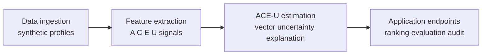

# ACE-U Trust Framework

[](https://github.com/sanandani/ace-u-trust-framework/actions/workflows/ci.yml)

**Scope: This is a synthetic-data-only reference implementation of Section VI's architecture and evaluation pathway for a conceptual paper. It is not empirically validated. It never uses real people's profiles.**

## Abstract

ACE-U represents professional identity through Authenticity, Credibility, Empathy, and Uniqueness. This repository provides a small, inspectable pathway from synthetic signals through dimension scores and explanations to multi-objective ranking and an offline evaluation comparison.

## Citation

Shubham Anandani, “Trust-Aware Professional Identity Representation in AI-Mediated Systems,” IEEE SoutheastCon 2026. Accepted manuscript in [`paper/`](paper/); © IEEE; see publisher terms. See [CITATION.cff](CITATION.cff).

## Quickstart

Requires Python 3.11+.

```sh
python -m venv .venv && source .venv/bin/activate
pip install -e ".[dev]"
pytest
python data/gen_synthetic.py
python eval/run.py
```

To start Oracle Database 23ai Free, apply the schema and audit policy, and run a score-table smoke query in one step, run `./scripts/verify_oracle.sh`. Set `ORACLE_PASSWORD`, `ORACLE_USER`, `ORACLE_APP_PASSWORD`, and `ORACLE_ADMIN_PASSWORD` via environment for local use. The default offline embedding provider is deterministic bag-of-skills; it makes no network calls and needs no secrets. An optional OCI Generative AI embedding adapter can implement the provider interface in `aceu/embeddings.py`; configure OCI SDK credentials only through environment configuration or OCI Vault. Never commit credentials.



## Paper sections to modules

| Paper section | Implementation |
|---|---|
| III–IV: dimensions and interactions | [docs/framework.md](docs/framework.md), `aceu/scoring.py` |
| V: observable signals and governance | `aceu/signals/`, `db/schema.sql`, `contest_log` |
| VI-A: four-layer reference implementation | `data/`, `aceu/signals/`, `aceu/scoring.py`, `aceu/rank.py` |
| VI-B: offline evaluation pathway | `eval/run.py` and generated synthetic report |
| VII: ranking, explanations and audit | `aceu/rank.py`, score explanations, Oracle Unified Auditing |

## Oracle technology

Oracle Database 23ai Free (`gvenzl/oracle-free`), python-oracledb, Oracle AI Vector Search (`VECTOR`, `VECTOR_DISTANCE`), and Unified Auditing. Skill embeddings default to a deterministic offline bag-of-skills vector; the provider is an interface, with OCI optional. Context-specific signal definitions and weights are YAML-configurable without code changes.

## Oracle ACE articles

[Oracle ACE series](https://imshubh.com/blog.html)
